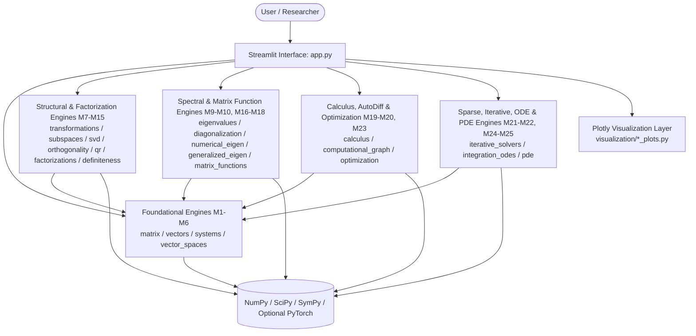

# 🧮 Computational Linear Algebra Laboratory

**An Interactive Scientific Computing, Numerical Analysis, Matrix Computation, Optimization, and Differential Equations Laboratory in Python**


---

## Introduction

**Computational Linear Algebra Laboratory** is a modular, full-stack scientific computing and educational platform built in Python. Designed as a bridge between abstract mathematical theory and production-grade numerical analysis, the laboratory integrates **25 progressive milestones** into a unified, interactive Streamlit environment alongside a decoupled Python computational API.

Rather than functioning as a black-box calculator, this laboratory exposes the underlying mechanics of computational mathematics: rank-revealing factorizations, subspace geometry, conditioning and perturbation sensitivity, exact symbolic versus floating-point trade-offs, forward and reverse automatic differentiation, Krylov subspace iterations for sparse systems, constrained numerical optimization, and the discretization of ordinary and partial differential equations.

> **Primary Objective:** Empower students, educators, numerical analysts, and scientific software engineers to formulate, solve, verify, and visualize problems across linear algebra, matrix calculus, optimization, and computational physics with explicit residual tracking and numerical stability diagnostics.

---

## Table of Contents

1. [Project Overview](#project-overview)
   - [Project Vision](#project-vision)
   - [Core Objectives](#core-objectives)
   - [Educational Goals](#educational-goals)
   - [Scientific Computing Goals](#scientific-computing-goals)
   - [Intended Audience](#intended-audience)
2. [Milestone Development History (M1–M25)](#milestone-development-history-m1m25)
   - [Milestone Summary Table](#milestone-summary-table)
   - [Milestones 1–12: Foundational & Structural Linear Algebra](#milestones-112-foundational--structural-linear-algebra)
   - [Milestones 13–25: Advanced Factorizations, Calculus, Solvers & PDEs](#milestones-1325-advanced-factorizations-calculus-solvers--pdes)
3. [Mathematical Foundations](#mathematical-foundations)
4. [Algorithms and Numerical Methods](#algorithms-and-numerical-methods)
5. [Major Features](#major-features)
6. [Applications](#applications)
7. [Visualization and Interactive Capabilities](#visualization-and-interactive-capabilities)
8. [Technology Stack](#technology-stack)
9. [Installation Guide](#installation-guide)
10. [Usage Guide](#usage-guide)
11. [Code Examples (Python API)](#code-examples-python-api)
12. [Project Architecture](#project-architecture)
13. [Numerical Accuracy and Reliability](#numerical-accuracy-and-reliability)
14. [Testing and Validation](#testing-and-validation)
15. [Performance and Scalability](#performance-and-scalability)
16. [Limitations](#limitations)
17. [Roadmap](#roadmap)
18. [Contributing Guidelines](#contributing-guidelines)
19. [Research and Educational Philosophy](#research-and-educational-philosophy)
20. [License and Acknowledgements](#license-and-acknowledgements)
21. [Frequently Asked Questions (FAQ)](#frequently-asked-questions-faq)

---

## Project Overview

### Project Vision
Modern scientific computing rests on the pillars of numerical linear algebra, matrix calculus, and discretized differential equations. Textbook treatments often isolate small, hand-crafted examples from the realities of floating-point arithmetic, ill-conditioning, and algorithmic complexity. Conversely, high-performance libraries often hide intermediate mathematical structures behind compiled routines. **Computational Linear Algebra Laboratory** bridges this divide by pairing reference LAPACK/SciPy numerical backends and SymPy exact symbolic engines with transparent, step-by-step intermediate diagnostics and interactive 2D/3D visualizations.

### Core Objectives
- **Unified Mathematical Engine:** Provide clean, modular Python packages covering matrix algebra, subspace topology, spectral decompositions, matrix functions, automatic differentiation, sparse iterative methods, nonlinear optimization, and differential equations.
- **Dual-Mode Computation:** Support floating-point numerical computation (via NumPy/SciPy) alongside exact symbolic computation (via SymPy) where mathematically required (such as Jordan Canonical Form or exact RREF).
- **Verification-First Design:** Pair every solver and factorization with explicit forward/backward residual norms, orthogonality checks, and condition-number diagnostics.

### Educational Goals
- Illustrate *why* mathematical assumptions matter (e.g., why Cholesky factorization and Conjugate Gradient require symmetric positive-definite matrices, or why unpivoted LU fails on zero pivots).
- Provide side-by-step tracing for foundational algorithms, including Gaussian elimination, Classical vs. Modified Gram–Schmidt, Householder reflections, Givens rotations, and reverse-mode computational graph backpropagation.
- Offer built-in **Educational Learning Modes** across laboratory tabs that explain theorems, derivations, and numerical caveats in context.

### Scientific Computing Goals
- Enforce numerically stable formulations: solving linear systems via triangular substitution or QR/SVD rather than explicit matrix inversion $A^{-1}$; avoiding normal equations $A^H A$ in favor of Householder QR or SVD; and using Padé scaling-and-squaring for matrix exponentials.
- Support sparse matrix storage (`CSR`, `CSC`, `DOK`) and matrix-free `LinearOperator` preconditioners (`Jacobi`, `ILU`) for large-scale discretized systems.

### Intended Audience
- **Undergraduate & Graduate Students** studying Linear Algebra, Numerical Analysis, Optimization, Scientific Computing, or Computational Physics.
- **Educators & Researchers** seeking interactive classroom demonstrations of spectral theory, conditioning, Krylov methods, and PDE stability (CFL conditions).
- **Python Developers & Machine Learning Engineers** looking to inspect the mathematical internals of SVD compression, automatic differentiation (JVP/VJP), and first-/second-order optimization landscapes.

---

## Milestone Development History (M1–M25)

### Milestone Summary Table

| Milestone | Title | Core Package / Module | Status |
| :--- | :--- | :--- | :--- |
| **M1** | Linear Algebra Foundations | `linear_algebra.matrix`, `linear_algebra.vectors` | ✅ Completed |
| **M2** | Advanced Matrix Operations | `linear_algebra.matrix.advanced_operations` | ✅ Completed |
| **M3** | Determinants, Rank & Matrix Structure | `minors_cofactors`, `singularity_analysis` | ✅ Completed |
| **M4** | Systems of Linear Equations ($AX = B$) | `linear_algebra.systems` | ✅ Completed |
| **M5** | Vector Spaces, Subspaces & Linear Independence | `linear_algebra.vector_spaces` | ✅ Completed |
| **M6** | Basis, Dimension & Coordinate Systems | `basis`, `dimension`, `coordinates` | ✅ Completed |
| **M7** | Linear Transformations & Matrix Representation | `linear_algebra.transformations` | ✅ Completed |
| **M8** | Fundamental Subspaces, Kernel, Image & Rank–Nullity | `linear_algebra.subspaces` | ✅ Completed |
| **M9** | Eigenvalues, Eigenvectors & Characteristic Polynomial | `linear_algebra.eigenvalues` | ✅ Completed |
| **M10** | Matrix Diagonalization, Similarity & Jordan Form | `linear_algebra.diagonalization` | ✅ Completed |
| **M11** | Singular Value Decomposition & Low-Rank Approx | `linear_algebra.svd` | ✅ Completed |
| **M12** | Orthogonality, Projections & Gram–Schmidt | `linear_algebra.orthogonality` | ✅ Completed |
| **M13** | QR Decomposition & Advanced Least-Squares | `linear_algebra.qr` | ✅ Completed |
| **M14** | LU, Cholesky & Advanced Matrix Factorizations | `linear_algebra.factorizations` | ✅ Completed |
| **M15** | Positive-Definite Matrices & Quadratic Forms | `linear_algebra.definiteness` | ✅ Completed |
| **M16** | Numerical Eigenvalue Algorithms & Schur Lab | `linear_algebra.numerical_eigen` | ✅ Completed |
| **M17** | Singular & Generalized Eigenvalue Problems | `linear_algebra.generalized_eigen` | ✅ Completed |
| **M18** | Matrix Functions: Exponential, Logarithm & Powers | `linear_algebra.matrix_functions` | ✅ Completed |
| **M19** | Advanced Matrix Calculus & Differentiation | `linear_algebra.calculus` | ✅ Completed |
| **M20** | Automatic Differentiation & Computational Graphs | `linear_algebra.calculus.computational_graph` | ✅ Completed |
| **M21** | Sparse Matrix Computation Foundations | Integrated via `scipy.sparse` in `iterative_solvers` & `pde` | ✅ Integrated |
| **M22** | Iterative Linear Solvers & Krylov Subspace Methods | `linear_algebra.iterative_solvers` | ✅ Completed |
| **M23** | Numerical Optimization & Constrained Optimization | `linear_algebra.optimization` | ✅ Completed |
| **M24** | Numerical Integration & Differential Equations | `linear_algebra.integration_odes` | ✅ Completed |
| **M25** | Partial Differential Equations & Computational Physics | `linear_algebra.pde` | ✅ Completed |

---

### Milestones 1–12: Foundational & Structural Linear Algebra

- **M1–M3 (Foundations, Advanced Operations & Structure):** Establishes `MatrixEngine` and `VectorEngine` supporting real, complex, and symbolic data. Implements matrix addition, multiplication, Hadamard product ($A \circ B$), Kronecker product ($A \otimes B$), element-wise division, scalar shifts ($A + \lambda I$), cofactor matrices, adjugates, determinant properties, and SVD-backed singularity/conditioning diagnostics.
- **M4 (Systems of Linear Equations):** Implements `LinearSystem`, Rouché–Capelli consistency classification ($\text{rank}(A)$ vs. $\text{rank}([A|B])$), step-by-step Gaussian elimination, parametric symbolic solvers, direct numerical solvers, and Frobenius residual verification $\|AX - B\|_F$.
- **M5–M6 (Vector Spaces, Basis & Coordinates):** Implements linear combinations, vector-space axiom exploration, span membership tests, linear independence analyzers, pivot-based redundant vector removal, coordinate mapping $[v]_B$, and change-of-basis matrices $P_{C \leftarrow B}$.
- **M7 (Linear Transformations):** Provides 2D/3D geometric transformation generators (rotations, reflections, scalings, shears), injectivity/surjectivity/bijectivity analysis, non-standard basis representations $[T]_{C \leftarrow B} = P_C^{-1} A P_B$, transformation composition $(S \circ T)(x) = BAx$, and 2D unit-circle deformation plots.
- **M8 (Four Fundamental Subspaces):** Computes bases and dimensions for $\text{Col}(A)$ (using original pivot columns of $A$), $\text{Null}(A)$, $\text{Row}(A)$, and $\text{LeftNull}(A) = \text{Null}(A^H)$. Verifies Rank–Nullity identities across domain and codomain, Hermitian orthogonal complement relations ($\text{Row}(A) \perp \text{Null}(A)$ and $\text{Col}(A) \perp \text{Null}(A^H)$), and rank-based subspace span/intersection comparisons.
- **M9–M10 (Eigenvalues, Diagonalization & Jordan Form):** Extracts characteristic polynomials $p(\lambda) = \det(\lambda I - A)$, pairs eigenvalues with eigenspaces $E_\lambda = \text{Null}(A - \lambda I)$, and compares Algebraic Multiplicity (AM) against Geometric Multiplicity (GM) to detect defective matrices. Implements $A = PDP^{-1}$, similarity transformations $B = P^{-1}AP$, spectral trace/determinant identities, and exact symbolic Jordan Canonical Form $A = PJP^{-1}$.
- **M11 (SVD & Low-Rank Approximation):** Computes full and reduced SVD ($A = U\Sigma V^H$), verifies Eckart–Young rank-$k$ truncation error bounds ($\|A - A_k\|_F$ and $\sigma_{k+1}$), constructs the Moore–Penrose pseudoinverse $A^+ = V\Sigma^+ U^H$ with verification of all four Moore–Penrose conditions, and solves minimum-norm least-squares problems.
- **M12 (Orthogonality & Projections):** Enforces Hermitian inner products $\langle u, v \rangle = u^H v$, constructs Gram matrices, implements Classical (CGS) and Modified Gram–Schmidt (MGS) with dependent-vector detection, builds SVD-backed orthogonal projection matrices $P = QQ^H$, verifies Pythagorean orthogonal decomposition $\|v\|^2 = \|p\|^2 + \|r\|^2$, and checks normal-equation residual orthogonality $A^H r \approx 0$.

---

### Milestones 13–25: Advanced Factorizations, Calculus, Solvers & PDEs

- **M13 (QR Decomposition & Least-Squares):** Implements full and reduced LAPACK QR, CGS/MGS QR, rank-revealing column-pivoted QR ($A[:, P] = QR$), educational step-by-step Householder reflections and Givens rotations, multi-RHS QR least squares ($RX = Q^H B$), and weighted least squares ($W^{1/2}Ax \approx W^{1/2}b$).
- **M14 (LU, Cholesky & Triangular Solvers):** Implements partial-pivoted LU ($PA = LU$), educational no-pivot LU with zero-pivot failure detection, Cholesky factorization ($A = LL^H$) with symmetry and positive-definiteness validation, symmetric indefinite $LDL^H$ factorization ($A = PLDL^H P^T$), and explicit forward/backward triangular substitution.
- **M15 (Positive-Definite Matrices & Quadratic Forms):** Classifies Hermitian matrices into PD, PSD, ND, NSD, or Indefinite using `eigvalsh`, evaluates Sylvester's criterion via leading principal minors, computes quadratic forms $q(x) = x^H A x$ and Rayleigh quotients $R_A(x)$, tests Loewner partial ordering ($A \succeq B \iff A - B \text{ is PSD}$), and renders 3D quadratic surface bowls.
- **M16 (Numerical Eigenvalue Algorithms & Schur Lab):** Implements Power Iteration, Shifted Inverse Iteration (solving $(A - \mu I)y = x$ without explicit matrix inversion), Rayleigh Quotient Iteration (RQI), educational unshifted QR iteration ($A_{k+1} = R_k Q_k$), Real and Complex Schur decomposition ($A = ZTZ^H$), and eigenvalue condition numbers $\kappa(\lambda) = (\|x\|_2 \|y\|_2)/|y^H x|$ with complex-plane perturbation plots.
- **M17 (Singular & Generalized Eigenvalue Problems):** Solves $Av = \lambda Bv$ using homogeneous coordinates $(\alpha, \beta)$ where $\lambda = \alpha/\beta$ to safely detect infinite eigenvalues when $B$ is singular, alongside specialized Cholesky-backed symmetric-definite solvers (`scipy.linalg.eigh`) verifying $B$-orthogonality ($V^H B V \approx I$) and generalized Rayleigh quotients.
- **M18 (Matrix Functions):** Computes Padé matrix exponentials $\exp(A)$ (`expm`) alongside truncated Taylor approximations, principal matrix logarithms $\log(A)$ (`logm`), matrix square roots $\sqrt{A}$ (`sqrtm`), fractional powers $A^\alpha$, trigonometric/hyperbolic matrix functions, and exact linear ODE trajectories $x(t) = e^{tA}x(0)$ with 2D phase-space plots.
- **M19–M20 (Matrix Calculus & Automatic Differentiation):** Implements safe symbolic differentiation (`sympy.parse_expr`) for gradients, Jacobians, and Hessians; central/forward/backward finite differences; matrix trace and log-determinant derivative identities; forward-mode AD via `Dual` numbers ($a + b\epsilon$); reverse-mode AD via a custom `Value` directed acyclic computational graph (DAG) with topological backpropagation; memory-free JVP ($J(x)v$) and VJP ($u^T J(x)$) engines; and optional PyTorch tensor AD integration.
- **M21–M22 (Sparse Matrices, Iterative Solvers & Krylov Subspaces):** Integrates `scipy.sparse` (`CSR`, `CSC`, `DOK`, `LIL`) generators for 1D/2D Poisson Laplacians and random sparse SPD systems. Implements Krylov solvers (`CG`, `GMRES`, `BiCGSTAB`, `MINRES`), stationary methods (`Jacobi`, `Gauss-Seidel`), `LinearOperator` preconditioners (`Jacobi`, `ILU` via `spilu`), and explicit Arnoldi ($AQ_k = Q_{k+1}H_k$) and Lanczos ($AQ_k = Q_k T_k$) basis generators.
- **M23 (Numerical & Constrained Optimization):** Implements unconstrained solvers (Gradient Descent, Adam, Newton's Method with linear solves, and Quasi-Newton BFGS) with Armijo backtracking line search, Quadratic Penalty constrained optimization, Karush–Kuhn–Tucker (KKT) condition verification, and nonlinear least squares (Gauss–Newton and damped Levenberg–Marquardt) over Sphere, Rosenbrock, and Himmelblau landscapes.
- **M24 (Numerical Integration & Differential Equations):** Implements Composite Trapezoidal, Composite Simpson's 1/3, Gauss–Legendre quadrature, adaptive QUADPACK integration, 1D Monte Carlo integration with standard error bounds, fixed-step ODE solvers (Euler, RK4), adaptive IVP solvers (`RK45`, stiff `BDF` on Van der Pol), and BVP collocation (`solve_bvp`).
- **M25 (Partial Differential Equations & Computational Physics):** Implements 1D and 2D spatial meshes (`Mesh1D`, `Mesh2D`), 2D elliptic Poisson sparse FDM solvers, 1D parabolic Crank–Nicolson implicit heat solvers, 1D hyperbolic Leapfrog wave solvers with CFL stability enforcement, nonlinear Burgers' shock evolution, 1D Galerkin Finite Element (FEM) stiffness assembly, 1D Upwind Finite Volume (FVM) conservation solvers, and FFT Spectral differentiation.

---

## Mathematical Foundations

The laboratory is organized around 15 interconnected mathematical domains:

### A. Linear Algebra & B. Matrix Theory
Linear systems and matrix factorizations govern discrete transformations between finite-dimensional vector spaces:

$$Ax = b, \quad A \in \mathbb{F}^{m \times n}, \quad \det(A) \neq 0 \iff A^{-1} \text{ exists (for } m=n\text{)}$$

### C. Vector Spaces & Fundamental Subspaces
Every matrix $A \in \mathbb{C}^{m \times n}$ of rank $r$ partitions its domain $\mathbb{C}^n$ and codomain $\mathbb{C}^m$ into four fundamental subspaces satisfying the Rank–Nullity Theorem and Hermitian orthogonality:

$$\dim(\text{Col}(A)) = \dim(\text{Row}(A)) = r, \quad \dim(\text{Null}(A)) = n - r, \quad \dim(\text{Null}(A^H)) = m - r$$

$$\text{Row}(A) \perp \text{Null}(A) \text{ in } \mathbb{C}^n, \quad \text{Col}(A) \perp \text{Null}(A^H) \text{ in } \mathbb{C}^m$$

### D. Matrix Factorizations
- **Partial-Pivoted LU:** $PA = LU$, where $P$ is a permutation matrix, $L$ is unit lower-triangular, and $U$ is upper-triangular.
- **Cholesky & Indefinite LDL:** $A = LL^H$ (for Hermitian positive-definite $A$) and $A = PLDL^H P^T$ (for symmetric/Hermitian indefinite $A$).
- **QR Factorization:** $A = QR$, where $Q^H Q = I$ and $R$ is upper-triangular.
- **Singular Value Decomposition (SVD):** $A = U\Sigma V^H$, yielding optimal rank-$k$ approximations $A_k = \sum_{i=1}^k \sigma_i u_i v_i^H$ with Eckart–Young error $\|A - A_k\|_2 = \sigma_{k+1}$ and $\|A - A_k\|_F = \sqrt{\sum_{i=k+1}^{\min(m,n)} \sigma_i^2}$.

### E. Spectral Theory & Generalized Eigenproblems
- **Standard & Schur Forms:** $Av = \lambda v$, diagonalization $A = PDP^{-1}$ (when $\sum \text{GM}(\lambda_i) = n$), Jordan Canonical Form $A = PJP^{-1}$, and unitary Schur triangulation $A = ZTZ^H$.
- **Generalized Pencil:** $Av = \lambda Bv \iff (A - \lambda B)v = 0$, represented in homogeneous coordinates $\lambda = \alpha / \beta$ to capture infinite modes when $\beta = 0$.

### F. Matrix Functions
For a square matrix $A$, the matrix exponential and autonomous linear ODE evolution are given by:

$$\exp(A) = \sum_{k=0}^{\infty} \frac{A^k}{k!}, \quad \frac{dx}{dt} = Ax \implies x(t) = e^{tA}x(0)$$

### G. Matrix Calculus & H. Automatic Differentiation
For $f: \mathbb{R}^n \to \mathbb{R}$ and $F: \mathbb{R}^n \to \mathbb{R}^m$, the gradient, Jacobian, and Hessian are defined as:

$$(\nabla f(x))_i = \frac{\partial f}{\partial x_i}, \quad J_{ij}(x) = \frac{\partial F_i}{\partial x_j}, \quad H_{ij}(x) = \frac{\partial^2 f}{\partial x_i \partial x_j}$$

Matrix calculus identities evaluated in the laboratory include:

$$\nabla_X \text{tr}(AX) = A^T, \quad \nabla_X \text{tr}(X^T A X) = (A + A^T)X, \quad \nabla_X \det(X) = \det(X) X^{-T}, \quad \nabla_X \log\det(X) = X^{-T}$$

Forward-mode AD propagates dual numbers $x + v\epsilon$ ($\epsilon^2 = 0$) to compute Jacobian-Vector Products $\text{JVP} = J(x)v$, while reverse-mode AD propagates cotangents backward through a topological DAG to compute Vector-Jacobian Products $\text{VJP} = u^T J(x)$.

### I. Sparse Linear Algebra & J. Iterative Krylov Methods
For large sparse $A$, Krylov methods seek approximations $x_k \in x_0 + \mathcal{K}_k(A, r_0)$ within the subspace:

$$\mathcal{K}_k(A, r_0) = \text{span}\{r_0, Ar_0, A^2 r_0, \dots, A^{k-1} r_0\}, \quad r_0 = b - Ax_0$$

### K. Numerical Optimization
Unconstrained and constrained optimization problems are formulated with Lagrangian and Karush–Kuhn–Tucker (KKT) optimality conditions:

$$\min_{x \in \mathbb{R}^n} f(x) \quad \text{s.t.} \quad h_i(x) = 0, \; g_j(x) \le 0$$

$$\nabla_x \mathcal{L}(x^*, \lambda^*, \mu^*) = \nabla f(x^*) + \sum_i \lambda_i^* \nabla h_i(x^*) + \sum_j \mu_j^* \nabla g_j(x^*) = 0, \quad \mu_j^* \ge 0, \quad \mu_j^* g_j(x^*) = 0$$

### L. Numerical Integration & M. Ordinary Differential Equations
Definite integrals and Initial/Boundary Value Problems are approximated via quadrature nodes $(x_i, w_i)$ and multi-stage Runge–Kutta integration:

$$\int_a^b f(x)\,dx \approx \sum_{i=1}^n w_i f(x_i), \quad \frac{dy}{dt} = f(t, y), \quad y(t_0) = y_0$$

### N. Partial Differential Equations & O. Computational Physics
Canonical elliptic, parabolic, hyperbolic, and nonlinear conservation PDEs modeled in the laboratory:

$$\nabla^2 u = f(x,y) \;\text{(Poisson)}, \quad \frac{\partial u}{\partial t} = \alpha \frac{\partial^2 u}{\partial x^2} \;\text{(Heat)}, \quad \frac{\partial^2 u}{\partial t^2} = c^2 \frac{\partial^2 u}{\partial x^2} \;\text{(Wave)}, \quad \frac{\partial u}{\partial t} + u\frac{\partial u}{\partial x} = \nu \frac{\partial^2 u}{\partial x^2} \;\text{(Burgers)}$$

---

## Algorithms and Numerical Methods

| Category | Implemented Algorithms | Mathematical Purpose & Input Assumptions | Numerical Limitations & Safeguards |
| :--- | :--- | :--- | :--- |
| **1. Direct Factorizations** | Partial-Pivoted LU (`spla.lu`), Educational No-Pivot LU, Cholesky (`spla.cholesky`), Pivoted $LDL^H$ (`spla.ldl`), Forward/Backward Substitution | Decompose square matrices for rapid triangular system solves $Ly = Pb, Ux = y$. Cholesky requires Hermitian Positive-Definite (HPD) input; $LDL^H$ requires symmetry. | No-pivot LU fails on zero pivots $\lvert U_{ii}\rvert < \text{tol}$. Cholesky raises an explicit error on indefinite or asymmetric inputs. |
| **2. Orthogonal & QR Methods** | LAPACK Full/Reduced QR, Column-Pivoted QR, Classical & Modified Gram–Schmidt, Householder Reflections, Givens Rotations | Orthonormalize bases ($Q^H Q = I$) and solve overdetermined least squares $RX = Q^H B$ without squaring $\kappa(A)$. | CGS suffers loss of orthogonality on ill-conditioned columns; MGS and Householder QR provide superior stability. Rank-deficient systems are flagged to use SVD. |
| **3. SVD & Pseudoinverse** | Full/Reduced SVD (`np.linalg.svd`), Truncated Rank-$k$ SVD, Moore–Penrose Pseudoinverse (`np.linalg.pinv`) | Compute singular spectra, matrix compression, condition numbers $\kappa_2(A) = \sigma_{\max}/\sigma_{\min}$, and minimum-norm least squares $x = A^+ b$. | Singular values below user tolerance are truncated to zero to prevent noise amplification in $A^+$. |
| **4. Spectral & Generalized Eigen** | Power Iteration, Shifted Inverse Iteration, Rayleigh Quotient Iteration (RQI), Educational QR Iteration, Real/Complex Schur (`spla.schur`), Homogeneous GEP (`spla.eig`), Symmetric-Definite GEP (`spla.eigh`), Symbolic Jordan Form | Compute eigenvalues/eigenvectors, Schur forms $ZTZ^H$, and generalized pencils $Av = \lambda Bv$. | Inverse iteration solves $(A - \mu I)y = x$ via LU rather than inverting. Jordan form is restricted to exact symbolic arithmetic due to discontinuity under perturbation. |
| **5. Matrix Functions** | Padé Exponential (`spla.expm`), Taylor Exponential, Principal Logarithm (`spla.logm`), Square Root (`spla.sqrtm`), Fractional Power, Trigonometric/Hyperbolic | Evaluate $f(A)$ and integrate linear autonomous ODEs $x(t) = e^{tA}x(0)$. | Taylor series suffers catastrophic cancellation for large $\|A\|$. `logm` rejects singular matrices ($\det(A) \approx 0$). |
| **6. Calculus & AutoDiff** | Symbolic (`sympy`), Central/Forward/Backward Finite Differences, Forward-Mode `Dual` AD, Reverse-Mode `Value` DAG AD, JVP/VJP, Optional PyTorch Tensor AD | Compute exact or approximate gradients, Jacobians, Hessians, and directional derivatives. | Finite differences trade off truncation error $O(h^2)$ against floating-point round-off $O(\epsilon_{\text{mach}}/h)$. AD achieves machine precision without symbolic expression swell. |
| **7. Sparse & Krylov Solvers** | Conjugate Gradient (`cg`), `GMRES`, `BiCGSTAB`, `MINRES`, `Jacobi`, `Gauss-Seidel`, Preconditioners (`Jacobi`, `ILU` via `spilu`), Arnoldi & Lanczos | Solve large sparse systems $Ax = b$ in $O(\text{nnz})$ memory per iteration. CG requires SPD $A$; MINRES requires symmetric $A$; GMRES/BiCGSTAB handle nonsymmetric $A$. | Stationary solvers require diagonal dominance or spectral radius $\rho < 1$. ILU drop-tolerance balances setup cost against iteration reduction. |
| **8. Numerical Optimization** | Gradient Descent, Adam, Newton's Method, Quasi-Newton BFGS, Armijo Backtracking Line Search, Quadratic Penalty, KKT Evaluator, Gauss–Newton, Levenberg–Marquardt | Minimize convex and non-convex objectives $f(x)$, constrained systems, and nonlinear residual squares $\|r(x)\|_2^2$. | Newton's method falls back to steepest descent if $\nabla^2 f$ is singular. Levenberg–Marquardt damps $J^T J + \lambda I$ to prevent rank-deficient steps. |
| **9. Quadrature & ODEs** | Trapezoidal, Simpson's 1/3, Gauss–Legendre, Adaptive QUADPACK (`spi.quad`), 1D Monte Carlo, Euler, RK4, Adaptive `RK45` / Stiff `BDF` (`solve_ivp`), BVP Collocation (`solve_bvp`) | Evaluate definite integrals and solve stiff/non-stiff IVPs and 2nd-order BVPs. | Simpson's 1/3 requires even subintervals. Stiff ODEs (e.g., Van der Pol $\mu=1000$) require implicit `BDF` to avoid tiny explicit step sizes. |
| **10. PDE & Physics Solvers** | 2D Sparse FDM Poisson, 1D Crank–Nicolson Heat, 1D Leapfrog Wave, 1D Explicit Burgers, 1D Galerkin Linear FEM, 1D Upwind FVM, 1D FFT Spectral Derivative | Discretize and simulate elliptic, parabolic, hyperbolic, and conservation PDEs. | Explicit wave ($\text{CFL} = c\Delta t/\Delta x \le 1$) and explicit diffusion ($r = \alpha \Delta t/\Delta x^2 \le 0.5$) enforce strict stability checks before time-stepping. |

---

## Major Features

- **28 Interactive Laboratory Pages:** Integrated into a single Streamlit navigation sidebar with global numerical tolerance controls ($10^{-1}$ to $10^{-15}$) and a toggleable **🎓 Educational Mode**.
- **Hybrid Symbolic & Numerical Engine:** Seamlessly switches between IEEE 754 floating-point arrays (`float64` / `complex128`) and exact SymPy rational/symbolic matrices.
- **Safe Mathematical Expression Parsing:** Uses `sympy.parsing.sympy_parser.parse_expr` with standard transformations rather than Python's `eval()`, preventing arbitrary code execution on user-supplied formulas.
- **Built-in Residual & Identity Verification:** Automatically checks $\|Ax - b\|_F$, $\|AA^{-1} - I\|_F$, $\|Q^H Q - I\|_F$, $\|ZTZ^H - A\|_F$, Moore–Penrose axioms, Rank–Nullity, B-orthogonality $\|V^H B V - I\|_F$, and KKT stationarity/feasibility.

---

## Applications

Every application in the laboratory is directly backed by an implemented computational module:

- **Structural Mechanics & Vibrations (M17):** Models mass-stiffness generalized eigenproblems $Kv = \omega^2 Mv$, including massless-node singular pencils with infinite homogeneous eigenvalues.
- **Data Compression & Low-Rank Reconstruction (M11):** Demonstrates Eckart–Young matrix compression and cumulative energy retention via truncated SVD.
- **Dynamical Systems & Phase-Space Analysis (M18, M24):** Simulates coupled harmonic oscillators, stiff Van der Pol relaxation oscillations, and continuous linear systems $\dot{x} = Ax$ via matrix exponentials.
- **Machine Learning Foundations (M19, M20, M23):** Illustrates reverse-mode backpropagation over computational graphs, Jacobian-Vector and Vector-Jacobian products, and trajectory comparisons between Gradient Descent, Adam, BFGS, and Newton's Method on Rosenbrock and Himmelblau surfaces.
- **Electrostatics, Heat Transfer & Wave Mechanics (M22, M25):** Solves 2D electrostatic/steady-heat Poisson potentials $\nabla^2 u = f(x,y)$, 1D thermal diffusion via Crank–Nicolson and linear Finite Elements, acoustic/string wave propagation, and shock-wave steepening in Burgers' equation.

---

## Visualization and Interactive Capabilities

All visualizations are powered by **Plotly** (`plotly.graph_objects`) and rendered interactively within Streamlit with zoom, pan, hover inspection, and 3D orbital rotation:

1. **3D Vector & Basis Plots (`visualization/vector_plots.py`):** Renders 3D vectors, cross products $u \times v$, and subspace basis spans.
2. **2D Geometric Transformation Plots (`visualization/transformation_plots.py`):** Overlays the original unit circle and standard basis $\{\hat{i}, \hat{j}\}$ against their transformed images $\{T(\hat{i}), T(\hat{j})\}$.
3. **SVD Spectrum & Energy Curves (`visualization/svd_plots.py`):** Plots linear/logarithmic singular value bar charts and cumulative squared-singular-value energy retention curves.
4. **3D Quadratic Form Surfaces (`visualization/quadratic_plots.py`):** Renders $q(x,y) = [x\; y] A [x\; y]^T$ alongside the $z=0$ reference plane to distinguish positive-definite bowls from indefinite saddles.
5. **Complex Spectrum & Convergence Plots (`visualization/eigen_plots.py`, `generalized_eigen_plots.py`):** Plots eigenvalues in the complex plane (tracking original vs. perturbed spectra and finite vs. infinite generalized modes) and logarithmic residual decay curves.
6. **ODE Phase Space & Time Series (`visualization/matrix_functions_plots.py`, `integration_ode_plots.py`):** Renders state trajectories $x_i(t)$, 2D phase portraits $(x_1(t), x_2(t))$, quadrature fill areas, and spatio-temporal heatmaps.
7. **Directed Computational Graph Renderer (`visualization/graph_plots.py`):** Topologically lays out reverse-mode `Value` nodes and dependency edges, displaying forward values $v$ and backpropagated gradients $\nabla$ inside each node.
8. **Optimization & PDE Landscapes (`visualization/optimization_plots.py`, `pde_plots.py`):** Plots multi-algorithm optimization paths over logarithmic contour maps, 3D Poisson potential surfaces, and 1D multi-time-slice PDE wave/diffusion profiles.

### Interface Screenshots Placeholder

> **Note:** No static screenshot image files are currently bundled in the repository. To capture screenshots locally, launch the application with `streamlit run app.py` and use your browser or Streamlit's export menu.
>
> - `[Placeholder: Home & Sidebar Navigation Overview]`
> - `[Placeholder: 2D Unit Circle Linear Transformation & SVD Energy Spectrum]`
> - `[Placeholder: Reverse-Mode AutoDiff Directed Computational Graph (DAG)]`
> - `[Placeholder: Rosenbrock Optimization Trajectories (GD vs. Adam vs. Newton vs. BFGS)]`
> - `[Placeholder: 2D Poisson Electrostatic Potential Surface & 1D Heat Evolution Heatmap]`

---

## Technology Stack

| Technology | Role in Repository |
| :--- | :--- |
| **Python 3.9+** | Core programming language and object-oriented modular architecture. |
| **NumPy** | Dense array storage, vector/matrix arithmetic, Kronecker/Hadamard operations, and Gauss–Legendre nodes. |
| **SciPy** | Production LAPACK factorizations (`lu`, `cholesky`, `ldl`, `qr`, `schur`, `eig`, `eigh`), matrix functions (`expm`, `logm`, `sqrtm`), sparse storage (`scipy.sparse`), Krylov solvers (`cg`, `gmres`, `bicgstab`, `minres`, `spilu`), quadrature (`quad`), ODE/BVP solvers (`solve_ivp`, `solve_bvp`), and FFT (`scipy.fft`). |
| **SymPy** | Exact symbolic RREF, nullspaces, characteristic polynomials, Jordan Canonical Form, symbolic gradients/Jacobians/Hessians, and safe algebraic expression parsing. |
| **Plotly** | Interactive 2D and 3D scientific visualizations, contour landscapes, phase portraits, and DAG network diagrams. |
| **Streamlit** | Web-based interactive dashboard, sidebar routing, LaTeX equation rendering, and parameter controls. |
| **Pandas** | Structured tabular display for multi-algorithm benchmarks and convergence summaries. |
| **Pytest** | Automated unit and regression testing across all 25 milestones. |
| **PyTorch** *(Optional)* | Optional CPU tensor backend in `linear_algebra/calculus/backend_ad.py` for verifying matrix calculus automatic differentiation. Gracefully degrades if not installed. |

---

## Installation Guide

### Prerequisites
- **Python:** Version `3.9` or higher.
- **Git:** For cloning the repository.
- **pip:** Python package installer.

### Step 1: Clone the Repository
```bash
​git clone [https://github.com/debo-flow/Computational-Linear-Algebra-Laboratory.git](https://github.com/debo-flow/Computational-Linear-Algebra-Laboratory.git)
cd Computational-Linear-Algebra-Laboratory
```

### Step 2: Create and Activate a Virtual Environment

**Linux / macOS:**
```bash
python3 -m venv .venv
source .venv/bin/activate
```

**Windows (Command Prompt / PowerShell):**
```cmd
python -m venv .venv
.venv\Scripts\activate
```

### Step 3: Install Dependencies
```bash
pip install --upgrade pip
pip install streamlit numpy scipy sympy plotly pandas pytest
```
*(Or, if using a `requirements.txt` file in your root directory:)*
```bash
pip install -r requirements.txt
```
*(Optional: To enable the PyTorch Matrix AD Backend in Milestone 20, install CPU PyTorch via `pip install torch`.)*

### Step 4: Launch the Interactive Laboratory
```bash
streamlit run app.py
```
Once launched, Streamlit will automatically open the laboratory in your default web browser at `http://localhost:8501`.

---

## Usage Guide

1. **Select a Laboratory Module:** Use the **Navigation** radio menu in the left sidebar to switch between any of the 28 specialized laboratories (from *Matrix Calculator* to *Advanced PDEs & Physics Lab*).
2. **Configure Global Settings:**
   - Toggle **🎓 Enable Educational Mode** in the sidebar to reveal contextual theorem explanations, stability notes, and mathematical derivations.
   - Adjust the **Numerical Tolerance ($10^{-x}$)** slider (default $10^{-9}$) to control rank estimation thresholds, singularity detection, and iterative solver stopping criteria.
3. **Input Conventions:**
   - **Matrices:** Enter rows separated by semicolons (`;`) and entries separated by commas (`,`). Complex numbers use `j` notation.
     - *Real Example:* `1, 2, 3; 4, 5, 6; 7, 8, 10`
     - *Complex Example:* `1, 1+2j; 1-2j, 3`
   - **Vector Sets / Bases:** Enter vectors separated by a pipe (`|`) and components separated by commas (`,`).
     - *Basis Example:* `1, 0, 0 | 0, 1, 0 | 1, 1, 1`
   - **Symbolic Functions:** Enter standard Python/SymPy mathematical expressions using `x`, `y`, `z` (e.g., `x**2 * y + sin(z)` or `sin(pi*x)*sin(pi*y)`).
4. **Interpret Diagnostics:** Review the computed LaTeX matrices alongside the reported Frobenius reconstruction errors, orthogonality residuals, condition numbers $\kappa(A)$, and interactive Plotly charts.

---

## Code Examples (Python API)

All mathematical engines are decoupled from the Streamlit UI and can be imported directly into Python scripts or Jupyter notebooks:

### 1. Four Fundamental Subspaces & Orthogonality Verification (M8)
```python
from linear_algebra.matrix.matrix_engine import MatrixEngine
from linear_algebra.subspaces.fundamental import FundamentalSubspaces
from linear_algebra.subspaces.orthogonality import SubspaceOrthogonality

A = MatrixEngine([[1, 2, 3], [4, 5, 6], [7, 8, 9]])
report = FundamentalSubspaces.analyze(A, tol=1e-9)

print(f"Rank: {report['rank']}, Nullity: {report['nullity']}")
is_ortho, residual = SubspaceOrthogonality.verify_orthogonality(
    report["row_space"]["basis"], report["null_space"]["basis"]
)
print(f"Row(A) ⊥ Null(A): {is_ortho} (Max Residual: {residual:.2e})")
```

### 2. Exact Symbolic Jordan Canonical Form (M10)
```python
from linear_algebra.matrix.matrix_engine import MatrixEngine
from linear_algebra.diagonalization.jordan import JordanCanonicalForm

# Defective 4x4 matrix
A = MatrixEngine([[5, 4, 2, 1], [0, 1, -1, -1], [-1, -1, 3, 0], [1, 1, -1, 2]], is_symbolic=True)
P, J = JordanCanonicalForm.compute(A)
print("Jordan Matrix J:\n", J.matrix)
```

### 3. SVD Low-Rank Approximation & Moore–Penrose Pseudoinverse (M11)
```python
from linear_algebra.matrix.matrix_engine import MatrixEngine
from linear_algebra.svd.approximation import LowRankApproximation
from linear_algebra.svd.pseudoinverse import PseudoinverseEngine

A = MatrixEngine([[1, 2], [3, 4], [5, 6]])
approx = LowRankApproximation.truncate(A, k=1)
print(f"Rank-1 Retained Energy: {approx['retained_energy_ratio']:.2%}")
print(f"Eckart-Young Frobenius Error: {approx['abs_error_frob']:.6f}")

A_plus = PseudoinverseEngine.compute(A)
mp_checks = PseudoinverseEngine.verify_mp_conditions(A, A_plus)
print("All 4 Moore-Penrose Conditions Valid:", mp_checks["all_valid"])
```

### 4. Forward & Reverse Automatic Differentiation: JVP & VJP (M19–M20)
```python
from linear_algebra.calculus.computational_graph.reverse_ad import Value
from linear_algebra.calculus.jvp_vjp import JVP_VJP_Engine

# Reverse-mode computational graph on a scalar function
x = Value(2.0, label="x")
y = Value(3.0, label="y")
f = (x ** 2) * y + x.sin()
f.backward()
print(f"f(2,3) = {f.data:.4f}, df/dx = {x.grad:.4f}, df/dy = {y.grad:.4f}")

# Memory-free JVP and VJP on a vector function F(x1, x2) = [x1^2 * x2, x1 + cos(x2)]
func = lambda x1, x2: [x1**2 * x2, x1 + x2.cos()]
_, jvp = JVP_VJP_Engine.jvp_forward(func, x_val=[1.0, 2.0], v_val=[0.5, -0.5])
_, vjp = JVP_VJP_Engine.vjp_reverse(func, x_val=[1.0, 2.0], u_val=[1.0, 1.0])
print("JVP J(x)v:", jvp)
print("VJP u^T J(x):", vjp)
```

### 5. Preconditioned Krylov Solver on a Sparse Poisson System (M22)
```python
import numpy as np
from linear_algebra.iterative_solvers.generators import MatrixGenerators
from linear_algebra.iterative_solvers.preconditioners import Preconditioners
from linear_algebra.iterative_solvers.solvers import IterativeSolvers

A_sparse = MatrixGenerators.poisson_2d(nx=30, ny=30)
b = np.ones(A_sparse.shape[0])
M_ilu = Preconditioners.ilu(A_sparse)

x, info, history = IterativeSolvers.cg(A_sparse, b, tol=1e-8, M=M_ilu)
print(f"Converged: {info == 0} in {len(history)} iterations (Final Rel. Residual: {history[-1]:.2e})")
```

### 6. Quasi-Newton BFGS Optimization & 2D Poisson PDE Solver (M23, M25)
```python
import numpy as np
from linear_algebra.optimization.functions import BenchmarkFunctions
from linear_algebra.optimization.unconstrained import UnconstrainedOptimization
from linear_algebra.pde.mesh import Mesh2D
from linear_algebra.pde.fdm import FiniteDifferencePDE

# Minimize 2D Rosenbrock function via BFGS
x_opt, hist, converged = UnconstrainedOptimization.bfgs(BenchmarkFunctions.rosenbrock, x0=[-1.2, 1.0])
print(f"Rosenbrock Minimum: {x_opt} in {len(hist)} steps")

# Solve 2D Poisson PDE \nabla^2 u = sin(pi*x)*sin(pi*y) on [0,1]x[0,1]
mesh = Mesh2D(Lx=1.0, Ly=1.0, nx=25, ny=25)
u_grid = FiniteDifferencePDE.solve_poisson_2d(
    mesh,
    f_rhs_func=lambda x, y: np.sin(np.pi * x) * np.sin(np.pi * y),
    bc_func=lambda x, y: 0.0
)
print("Computed 2D PDE Grid Shape:", u_grid.shape)
```

---

## Project Architecture

### System Architecture Diagram



### Repository Directory Structure

```text
Computational-Linear-Algebra-Laboratory/
├── app.py                                      # Main Streamlit application entry point (M1–M25 UI)
├── LICENSE                                     # MIT License
├── README.md                                   # Project documentation
├── linear_algebra/                             # Core mathematical and numerical computing package
│   ├── matrix/                                 # M1–M3: MatrixEngine, operations, minors, singularity, validation
│   ├── vectors/                                # M1: VectorEngine (dot/cross products, norms)
│   ├── systems/                                # M4: LinearSystem, Rouché-Capelli classifier, solvers, elimination
│   ├── vector_spaces/                          # M5–M6: Spans, independence, subspaces, basis, dimension, coordinates
│   ├── transformations/                        # M7: 2D/3D geometric transforms, [T]_{C<-B}, composition
│   ├── subspaces/                              # M8: Col(A), Null(A), Row(A), LeftNull(A), orthogonality, comparison
│   ├── eigenvalues/                            # M9: EigenEngine, characteristic polynomials, spectral diagnostics
│   ├── diagonalization/                        # M10: PDP^-1 diagonalization, similarity P^-1AP, functions, Jordan form
│   ├── svd/                                    # M11: Full/reduced SVD, Eckart-Young truncation, Moore-Penrose A^+
│   ├── orthogonality/                          # M12: Hermitian inner products, CGS/MGS Gram-Schmidt, projections
│   ├── qr/                                     # M13: LAPACK/Pivoted/GS QR, Householder/Givens steps, WLS/QR-LS
│   ├── factorizations/                         # M14: Partial/No-pivot LU, Cholesky, LDL^H, triangular substitution
│   ├── definiteness/                           # M15: PD/PSD/ND/Indefinite classifier, Sylvester, quadratic forms, Loewner
│   ├── numerical_eigen/                        # M16: Power/Inverse/RQI iteration, QR iteration, Schur ZTZ^H, sensitivity
│   ├── generalized_eigen/                      # M17: Homogeneous GEP (alpha/beta), symmetric-definite eigh, pencils
│   ├── matrix_functions/                       # M18: expm, Taylor exp, logm, sqrtm, fractional power, linear ODEs
│   ├── calculus/                               # M19–M20: Symbolic/numerical derivatives, Dual AD, JVP/VJP, matrix rules
│   │   └── computational_graph/                # M20: Reverse-mode Value node DAG engine & topological backprop
│   ├── iterative_solvers/                      # M21–M22: Sparse Poisson/SPD generators, CG/GMRES/BiCGSTAB/MINRES, ILU, Arnoldi/Lanczos
│   ├── optimization/                           # M23: Benchmark functions, GD/Adam/Newton/BFGS, Penalty/KKT, GN/LM NLLS
│   ├── integration_odes/                       # M24: Trapezoidal/Simpson/Gauss/QUADPACK/MC, Euler/RK4/RK45/BDF, BVP
│   └── pde/                                    # M25: Mesh1D/Mesh2D, 2D Poisson FDM, Crank-Nicolson, Wave, Burgers, FEM, FVM, Spectral
├── visualization/                              # Modular Plotly visualization generators
│   ├── vector_plots.py
│   ├── matrix_plots.py
│   ├── transformation_plots.py
│   ├── svd_plots.py
│   ├── quadratic_plots.py
│   ├── eigen_plots.py
│   ├── generalized_eigen_plots.py
│   ├── matrix_functions_plots.py
│   ├── calculus_plots.py
│   ├── graph_plots.py
│   ├── iterative_plots.py
│   ├── optimization_plots.py
│   ├── integration_ode_plots.py
│   └── pde_plots.py
└── tests/                                      # Automated pytest validation suite
    ├── test_transformations.py
    ├── test_fundamental_subspaces.py
    ├── test_eigenvalues.py
    ├── test_diagonalization.py
    ├── test_svd.py
    ├── test_orthogonality.py
    ├── test_qr.py
    ├── test_factorizations.py
    ├── test_definiteness.py
    ├── test_numerical_eigen.py
    ├── test_generalized_eigen.py
    ├── test_matrix_functions.py
    ├── test_calculus.py
    ├── test_autodiff_graph.py
    ├── test_iterative_solvers.py
    ├── test_optimization.py
    ├── test_integration_odes.py
    └── test_pde.py
```

---

## Numerical Accuracy and Reliability

Scientific computing requires distinguishing between **exact mathematical identities** and **finite-precision floating-point approximations**:

1. **Avoidance of Explicit Matrix Inversion:** Across linear system solvers (M4, M13, M14), projections (M12), inverse iteration (M16), generalized eigenproblems (M17), and Newton optimization steps (M19, M23), the laboratory uses triangular back-substitution, LU/QR/SVD factorizations, or `scipy.linalg.solve` rather than forming $A^{-1}$.
2. **Avoidance of Normal-Equation Conditioning Squaring:** Since $\kappa_2(A^H A) = \kappa_2(A)^2$, least-squares problems and projection matrices ($P = QQ^H$) are computed using SVD or Householder QR rather than inverting $A^H A$.
3. **Scale-Aware Residual Reporting:** Factorizations report normalized Frobenius reconstruction errors:
   $$\text{Relative Error} = \frac{\|A - A_{\text{reconstructed}}\|_F}{\max(\|A\|_F, 10^{-15})}$$
4. **Conditioning vs. Residual Awareness:** Small residuals $\|Ax - b\|_2$ do not guarantee small forward errors $\|x - x_{\text{true}}\|_2$ when the condition number $\kappa(A) = \sigma_{\max}/\sigma_{\min}$ is large. The laboratory surfaces explicit warnings whenever $\kappa(A) > 10^{10}$.
5. **Symbolic Fallback for Discontinuous Structures:** Structures that are mathematically discontinuous under arbitrary floating-point perturbations—most notably the **Jordan Canonical Form** (M10)—are strictly routed through SymPy's exact rational arithmetic.

---

## Testing and Validation

The repository includes an automated **Pytest** suite inside the `tests/` directory that validates mathematical invariants, reconstruction residuals, orthogonality conditions, and domain error handling.

### Running the Full Test Suite
```bash
pytest
```

### Running Specific Milestone Tests
```bash
pytest tests/test_fundamental_subspaces.py
pytest tests/test_svd.py
pytest tests/test_factorizations.py
pytest tests/test_autodiff_graph.py
pytest tests/test_iterative_solvers.py
pytest tests/test_optimization.py
pytest tests/test_integration_odes.py
pytest tests/test_pde.py
```

### What the Test Suite Validates
- **Subspace & Orthogonal Identities:** Verifies that $\text{Col}(A)$ retains original columns of $A$, $\text{Row}(A) \perp \text{Null}(A)$, $P^2 = P = P^H$ for projection matrices, and $Q^H Q = I$ for QR and Arnoldi bases.
- **Factorization Reconstructions:** Verifies $P^T L U = A$, $LL^H = A$, $PLDL^H P^T = A$, $U\Sigma V^H = A$, and $ZTZ^H = A$ within floating-point tolerances (`atol=1e-9`).
- **Calculus & AutoDiff Verification:** Compares forward-mode `Dual` numbers, reverse-mode `Value` backpropagation, JVP/VJP products, and central finite differences against analytical SymPy derivatives.
- **Stability & Edge-Case Guards:** Confirms that singular matrices raise explicit `ValueError` exceptions in `logm` and non-pivoted LU, non-PD matrices are rejected by Cholesky and Symmetric-Definite GEP solvers, and CFL violations ($c\Delta t/\Delta x > 1$) are caught before PDE time-stepping.

---

## Performance and Scalability

- **Dense vs. Sparse Representations:** Milestones 1–20 operate primarily on dense NumPy/SymPy matrices ($O(n^2)$ storage, $O(n^3)$ direct factorizations), which are ideal for interactive exploration up to $n \approx 500$.
- **Sparse & Matrix-Free Scaling (M21–M22, M25):** Large-scale discretized systems (such as 1D/2D Poisson grids up to $N = 10,000$ in the UI) use `scipy.sparse` (`CSR`, `CSC`, `DOK`) storage and `LinearOperator` preconditioners, reducing memory and per-iteration matrix-vector multiplication costs to $O(\text{nnz})$.
- **Memory-Free JVP & VJP (M20):** Forward-mode JVP and reverse-mode VJP compute directional products $J(x)v$ and $u^T J(x)$ in $O(n)$ memory without materializing the full $m \times n$ Jacobian matrix.

---

## Limitations

To maintain scientific transparency, users should be aware of the following architectural and numerical boundaries:

1. **Floating-Point Rank & Multiplicity Estimation:** Numerical rank (`SVD`, `Pivoted QR`) and numerical eigenvalue clustering (M9, M16) depend on the user-selected tolerance $\text{tol}$. Closely spaced eigenvalues or singular values near $\text{tol}$ may change classification when tolerance is adjusted.
2. **Educational vs. Production Implementations:** Step-by-step modules (No-Pivot LU, Classical Gram–Schmidt, unshifted QR eigenvalue iteration, explicit Householder/Givens trackers, and scalar `Value` DAG nodes) are designed for pedagogical clarity on small matrices and should not be used for large-scale production workloads.
3. **Reverse-Mode AD Scope:** The custom `Value` graph engine in `reverse_ad.py` operates on scalar computational nodes to visualize DAG topologies clearly; tensor-level reverse-mode AD requires the optional PyTorch backend (`backend_ad.py`).
4. **PDE & FEM Dimensionality:** The Finite Element (`fem.py`), Finite Volume (`fvm.py`), and Spectral (`spectral.py`) modules are implemented for 1D domains with structured boundary conditions, while 2D PDE solving is provided for rectangular Dirichlet domains via sparse Finite Differences (`fdm.py`). Unstructured 2D/3D triangular/tetrahedral mesh generation is not included.

---

## Roadmap

### Completed
- [x] **Milestones 1–12:** Core Matrix/Vector Engines, Linear Systems, Vector Spaces, Basis/Coordinates, Linear Transformations, Fundamental Subspaces, Eigenvalues, Diagonalization/Jordan Form, SVD, and Orthogonality/Projections.
- [x] **Milestones 13–20:** QR & Weighted Least Squares, LU/Cholesky/$LDL^H$, Positive-Definite & Quadratic Forms, Iterative Eigenvalue & Schur Lab, Generalized Eigenproblems, Matrix Functions, Matrix Calculus, and Forward/Reverse Automatic Differentiation.
- [x] **Milestones 21–25:** Sparse Matrix Generators, Krylov Subspace Solvers & Preconditioners, Unconstrained/Constrained Numerical Optimization, Numerical Quadrature & ODE/BVP Solvers, and PDE/Computational Physics Discretizations.

### Planned Future Directions
- [ ] **2D Unstructured Finite Element Meshing:** Delaunay triangulation and 2D Galerkin assembly.
- [ ] **Tensor Decompositions:** CP (CANDECOMP/PARAFAC) and Tucker decompositions for multilinear algebra.
- [ ] **GPU/JAX Acceleration Backend:** Expanding `backend_ad.py` to support hardware-accelerated vectorization and higher-order Hessian-vector products via JAX.
- [ ] **Report Export Engine:** Exporting interactive laboratory runs directly to downloadable LaTeX/PDF worksheets.

---

## Contributing Guidelines

Contributions that enhance mathematical rigor, numerical stability, educational clarity, or test coverage are welcome!

1. **Fork the Repository** and create a feature branch:
   ```bash
   git checkout -b feature/your-mathematical-feature
   ```
2. **Follow Architectural Separation:**
   - Place pure mathematical and numerical algorithms inside the appropriate subpackage of `linear_algebra/`.
   - Place Plotly figure generators inside `visualization/`.
   - Keep `app.py` focused on Streamlit UI presentation and input routing.
3. **Add Automated Tests:** Add corresponding `pytest` unit tests in `tests/` using `np.isclose` / `np.allclose` with justified tolerances rather than exact floating-point equality.
4. **Verify Existing Functionality:** Run `pytest` to ensure all previous milestones pass without regression.
5. **Submit a Pull Request** detailing the mathematical formulation, algorithmic assumptions, and numerical limitations of your contribution.

---

## Research and Educational Philosophy

**Computational Linear Algebra Laboratory** is built on three guiding principles:

1. **Computation Illuminates Theory:** Abstract theorems—such as the Fundamental Theorem of Linear Algebra ($\text{Row}(A) \perp \text{Null}(A)$), the Eckart–Young theorem, or the Courant–Friedrichs–Lewy (CFL) condition—become intuitive when students can perturb inputs, inspect intermediate matrices, and watch stability boundaries in real time.
2. **Transparency Over Black Boxes:** A numerical result without a residual norm or condition number is incomplete. Every solver in this laboratory is designed to expose *how* the answer was obtained and *how reliable* it is.
3. **Computation Supports—Never Replaces—Proof:** Empirical numerical checks (such as testing linearity or vector space axioms on finite vectors) are explicitly labeled as computational evidence rather than universal mathematical proofs.

---

## License and Acknowledgements

### License
This project is licensed under the **MIT License** — see the [`LICENSE`](LICENSE) file for full details.

- **Copyright:** Copyright (c) 2026 Deborudra De

### Acknowledgements
Built upon the open-source scientific Python ecosystem, including **NumPy**, **SciPy** (and the underlying **LAPACK/BLAS** and **QUADPACK/SuperLU** libraries), **SymPy**, **Plotly**, **Pandas**, **Pytest**, and **Streamlit**.

---

## Frequently Asked Questions (FAQ)

**1. What is Computational Linear Algebra Laboratory?**  
It is an open-source Python and Streamlit platform combining 25 modular laboratories for matrix computation, subspace geometry, spectral theory, automatic differentiation, sparse iterative solvers, numerical optimization, and differential equations.

**2. Who is this project intended for?**  
Students, educators, researchers, numerical analysts, and engineers studying or applying linear algebra, scientific computing, machine learning mathematics, and computational physics.

**3. Do I need advanced mathematics knowledge to use it?**  
No. Each laboratory tab includes default preset matrices/functions and an optional **🎓 Educational Mode** that explains definitions, formulas, and geometric interpretations step by step.

**4. Which programming language is used?**  
The entire project is written in **Python** (compatible with Python 3.9+).

**5. Does the project support sparse matrices?**  
Yes. Milestones 21–22 and 25 use `scipy.sparse` (`CSR`, `CSC`, `DOK`, `LIL`) matrices and `LinearOperator` preconditioners to solve large-scale systems without dense memory conversion.

**6. Does it support numerical optimization?**  
Yes. Milestone 23 implements Gradient Descent, Adam, Newton's Method, BFGS, Armijo backtracking line search, Quadratic Penalty constrained optimization, KKT verification, Gauss–Newton, and Levenberg–Marquardt.

**7. Can it solve differential equations?**  
Yes. Milestone 18 solves linear ODE systems analytically via $\exp(tA)x(0)$, and Milestone 24 solves nonlinear IVPs (`Euler`, `RK4`, `RK45`), stiff systems (`BDF`), and 2nd-order Boundary Value Problems (`solve_bvp`).

**8. Does it include PDE solvers?**  
Yes. Milestone 24 and Milestone 25 implement 2D elliptic Poisson (FDM), 1D parabolic Heat (FTCS & Crank–Nicolson), 1D hyperbolic Wave (Leapfrog), 1D nonlinear Burgers' equation, 1D linear Finite Elements (FEM), 1D Upwind Finite Volumes (FVM), and 1D FFT Spectral differentiation.

**9. How can I run the application locally?**  
Install the dependencies (`pip install streamlit numpy scipy sympy plotly pandas pytest`) and run `streamlit run app.py` from the repository root.

**10. How can I contribute?**  
Fork the repository, add your modular algorithm under `linear_algebra/`, add unit tests under `tests/`, verify with `pytest`, and open a Pull Request.

**11. Are all numerical results exact?**  
No. Floating-point computations are subject to IEEE 754 precision limits and matrix conditioning. Exact arithmetic is available in modules that support SymPy symbolic mode (such as RREF, nullspaces, characteristic polynomials, and Jordan Canonical Form).

**12. Can the laboratory be used for research and teaching?**  
Yes. Under the MIT License, you are free to use, modify, and distribute the laboratory for academic courses, homework verification, classroom demonstrations, and research prototyping.
